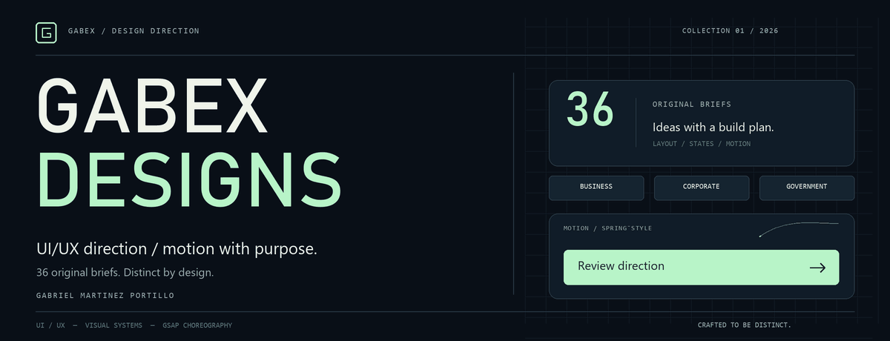

<div align="center">
  <picture>
    <source media="(prefers-reduced-motion: reduce)" srcset="assets/readme/gabex-banner-static.png">
    
  </picture>

  <h1>Gabex Designs</h1>

  <p><strong>Considered interfaces. Expressive motion. Clear UX.</strong></p>

  <p>36 detailed UI/UX design briefs for business, corporate, government, and creative products.<br>Responsive layouts, distinct visual systems, GSAP choreography, and spring-style interactions.</p>

  <p></p>

  <p>Created by <strong>Gabriel Martinez Portillo</strong></p>

  <p>
    <a href="#design-library">Explore the library</a> &nbsp; · &nbsp;
    <a href="#government-and-public-services">Government</a> &nbsp; · &nbsp;
    <a href="#corporate-and-enterprise">Corporate</a> &nbsp; · &nbsp;
    <a href="#business-and-commercial-operations">Business</a> &nbsp; · &nbsp;
    <a href="00-gsap-motion-playbook.md">Motion playbook</a> &nbsp; · &nbsp;
    <a href="LICENSE.md">License</a>
  </p>

  <p><sub><a href="assets/readme/gabex-banner-static.png">View the static banner</a> · The animation plays once and settles into its final composition.</sub></p>
</div>

---

## Start here

Gabex Designs turns a product idea into a concrete design direction. Each brief defines who the interface serves, how its screens fit together, what it looks like, and how its interactions should feel.

Choose a starting point:

| Your project | A useful first brief | What to explore |
| --- | --- | --- |
| A public-service portal | [CivicOne](25-civicone-public-services.md) | Service discovery, application review, and clear status tracking |
| A corporate website | [Crestline](29-crestline-corporate-group.md) | Business divisions, company narrative, and a publication center |
| A working business tool | [Dockside](33-dockside-wholesale.md) | Bulk ordering, quantity tiers, stock context, and order review |
| An expressive portfolio | [Studio Index](21-studio-index.md) | Exhibition-style typography, project indexing, and selected previews |

These files are design specifications with fictional sample content. Product implementation, assets, integrations, and verified production content are supplied during a build.

## Inside every brief

| Section | The decisions it makes concrete |
| --- | --- |
| **01 · Product and core flow** | Audience, primary task, screen-to-screen journey, and meaningful interface copy |
| **02 · Visual system** | Exact color roles, font pairings and fallbacks, typography, spacing, and surfaces |
| **03 · Screen composition** | A specific 1440 px desktop layout and a deliberate 390 px mobile transformation |
| **04 · Interaction and states** | Selection, keyboard behavior, loading, empty results, errors, and success |
| **05 · GSAP motion choreography** | Targets, triggers, APIs, duration, easing, and the purpose of each transition |
| **06 · Signature button** | Press and release values, spring-style feedback, focus, and reduced motion |
| **07 · Accessibility and performance** | Semantic controls, input alternatives, asset priorities, and motion cleanup |
| **08 · Build acceptance criteria** | Observable checks for the completed experience |

## Design library

Six collections, each with a different product context and information structure. Every title opens its complete Markdown brief.

### Government and public services

**04 briefs / 25–28** · Plain-language services, reviewable decisions, and dependable public information.

| No. | Design direction | Experience and signature focus |
| --- | --- | --- |
| 25 | [CivicOne Public Services](25-civicone-public-services.md) | Citizen portal · Guided discovery, application preparation, save/resume, and secure status tracking |
| 26 | [PermitDesk Case Management](26-permitdesk-case-management.md) | Reviewer workspace · Evidence-led review, decision reasons, and version-aware case history |
| 27 | [District Works](27-district-works.md) | Public works · Accessible maintenance reporting, location context, and accountable staff triage |
| 28 | [Public Ledger Transparency](28-public-ledger-transparency.md) | Budget publication · Source-led comparisons, explicit periods and units, and accessible datasets |

### Corporate and enterprise

**04 briefs / 29–32** · An authoritative public presence and focused internal workspaces.

| No. | Design direction | Experience and signature focus |
| --- | --- | --- |
| 29 | [Crestline Corporate Group](29-crestline-corporate-group.md) | Corporate website · Editorial division overview, organization structure, and investor publications |
| 30 | [Accord People Operations](30-accord-people-operations.md) | Employee workspace · Personal tasks, leave requests, approval context, and record visibility |
| 31 | [Origin Procurement](31-origin-procurement.md) | Enterprise purchasing · Comparable supplier evidence, requisition review, and explicit approval states |
| 32 | [Council Governance Workspace](32-council-governance-workspace.md) | Board portal · Agenda-led preparation, versioned packs, recorded decisions, and assigned actions |

### Business and commercial operations

**04 briefs / 33–36** · Tools for ordering, serving customers, managing relationships, and delivering work.

| No. | Design direction | Experience and signature focus |
| --- | --- | --- |
| 33 | [Dockside Wholesale](33-dockside-wholesale.md) | B2B ordering · Quantity-aware catalog, backorder clarity, and transparent order review |
| 34 | [Counterline Retail Operations](34-counterline-retail-operations.md) | Retail and POS · Held sales, stock counts, counter workflow, and explicit reconciliation states |
| 35 | [Align Client Relationships](35-align-client-relationships.md) | CRM · Relationship context, stable pipeline views, and deliberate follow-up drafts |
| 36 | [Pavilion Client Portal](36-pavilion-client-portal.md) | Client delivery · Milestones, versioned file review, approvals, and revision requests |

### Commerce and booking

**06 briefs** · Product detail, material choice, hospitality, and spatial reservations.

<details>
<summary><strong>Explore all 6 commerce and booking directions</strong></summary>

| No. | Design direction | Experience and signature focus |
| --- | --- | --- |
| 03 | [Ember House](03-ember-house.md) | Restaurant · Warm hospitality, menu storytelling, and a practical reservation flow |
| 05 | [Forma Type Foundry](05-forma-type-foundry.md) | Font commerce · Live specimens, typographic controls, and clear licensing choices |
| 07 | [Stillwater Ceramics](07-stillwater-ceramics.md) | Object commerce · Tactile photography and asymmetric product stories |
| 13 | [Alder & Loom](13-alder-and-loom.md) | Furniture configurator · Material-library surfaces and clear configuration choices |
| 19 | [Vesper Timepieces](19-vesper-timepieces.md) | Watchmaker · Technical folios, macro imagery, and explorable mechanism layers |
| 22 | [Common Ground](22-common-ground-workspaces.md) | Coworking · Architectural floorplans, a complete list alternative, and booking review |

</details>

### Editorial and creative

**09 briefs** · Distinct art direction, purposeful storytelling, and confident reading experiences.

<details>
<summary><strong>Explore all 9 editorial and creative directions</strong></summary>

| No. | Design direction | Experience and signature focus |
| --- | --- | --- |
| 01 | [Obsidian Atelier](01-obsidian-atelier.md) | Architecture · Spatial editorial spreads and project-led discovery |
| 04 | [Northline Expeditions](04-northline-expeditions.md) | Expedition planning · Terrain-led editorial and itinerary chapters |
| 10 | [Prism Research](10-prism-research.md) | Research studio · Visible methods, evidence, and structured inquiry |
| 11 | [Orbit Creative Studio](11-orbit-creative-studio.md) | Creative agency · Storyboard case studies and controlled reveals |
| 12 | [Sunday Makers Market](12-sunday-makers-market.md) | Community directory · Maker-first discovery and personable listing details |
| 16 | [Mono Film Archive](16-mono-film-archive.md) | Film journal · Cinematic stills, rich credits, and long-form reading |
| 21 | [Studio Index](21-studio-index.md) | Art-director portfolio · Exhibition catalogue, ruled index, and selected image previews |
| 23 | [Solstice Festival](23-solstice-festival.md) | Festival · Screen-printed poster energy and conflict-aware personal planning |
| 24 | [Fieldnote Conservation](24-fieldnote-conservation.md) | Field journal · Evidence provenance and accessible project maps |

</details>

### Product tools and operations

**09 briefs** · Clear data, stable workspaces, and responsive feedback for repeated tasks.

<details>
<summary><strong>Explore all 9 product and operations directions</strong></summary>

| No. | Design direction | Experience and signature focus |
| --- | --- | --- |
| 02 | [Voltgrid Operations](02-voltgrid-operations.md) | Fleet charging · Departure readiness, exceptions, and stable live information |
| 06 | [Sentinel Security](06-sentinel-security.md) | Account security · Legible risk states, sessions, and recovery |
| 08 | [Cadence Practice Room](08-cadence-practice-room.md) | Musician workspace · Practice sequencing and intentional audio control |
| 09 | [Harbor Ledger](09-harbor-ledger.md) | Invoice workspace · Document hierarchy and cash-collection states |
| 14 | [Meridian Weather](14-meridian-weather.md) | Weather intelligence · Timestamped conditions, unit clarity, and forecast comparison |
| 15 | [Kinship Volunteers](15-kinship-volunteers.md) | Volunteer coordination · Shift-first planning and clear commitments |
| 17 | [Pulseboard Esports](17-pulseboard-esports.md) | Tactical analysis · Timeline inspection and stable match review |
| 18 | [Parcel Field](18-parcel-field.md) | Logistics · Exception-first triage and dependable shipment context |
| 20 | [Relay Developer Console](20-relay-developer-console.md) | API documentation · Labeled mock requests, readable examples, and crisp code feedback |

</details>

## Motion language

Motion connects an action to its result. Each brief gives it a specific purpose and a level of expression suited to the product.

| Interaction | Direction |
| --- | --- |
| **Buttons** | A stationary hit area and focus ring, with a responsive inner face and spring-style release |
| **Selections** | Immediate state changes supported by a small indicator or detail transition |
| **Editorial sections** | Short, deliberate entrances with normal document scrolling |
| **Operational data** | Stable values, rows, and focus during updates |
| **Reduced motion** | Complete static compositions and immediate, readable state feedback |

The briefs specify GSAP timelines, easing, and ScrollTrigger where useful. Spring-style curves such as `back.out(...)` describe overshoot rather than a physical spring simulation.

**[Read the GSAP motion playbook →](00-gsap-motion-playbook.md)**

## Build from a brief

1. **Choose the product context.** Read the complete brief, including the mobile composition and failure states.
2. **Supply the real content.** Add suitable assets, verified information, and the integrations the product needs.
3. **Implement and review.** Follow the visual system and motion guidance, then verify the brief's acceptance criteria with keyboard, touch, and reduced motion.

For an authorized implementation, this handoff can accompany the selected file:

```text
Use the attached design brief as the source of truth.

Preserve its layout hierarchy, typography, color roles, responsive
transformations, interface states, and signature interaction.

Implement the core user flow first, then add the specified GSAP motion.
Keep primary actions immediate. Include keyboard and reduced-motion
behavior, and mark remaining sample content clearly.

Verify the brief's acceptance criteria before delivery.
```

<details>
<summary><strong>About the README animation</strong></summary>

The banner is repository-local artwork. Its GIF plays one short sequence and holds the final frame. A `<picture>` source selects the static PNG when reduced motion is requested; a [direct static version](assets/readme/gabex-banner-static.png) is also available.

The README embeds the rendered artwork. GSAP behavior is documented in the design briefs for product implementations.

To regenerate the banner, install Pillow and run the [asset generator](scripts/build_readme_assets.py):

```sh
python -m pip install Pillow
python scripts/build_readme_assets.py
```

</details>

---

## Creator and license

**Gabriel Martinez Portillo** · Gabex Designs

Copyright © 2026 Gabriel Martinez Portillo. **All rights reserved.**

See [LICENSE.md](LICENSE.md) for the proprietary terms, applicable exceptions, and third-party exclusions.

<p align="center"><sub>Design with intent. Make every interaction count.</sub></p>
